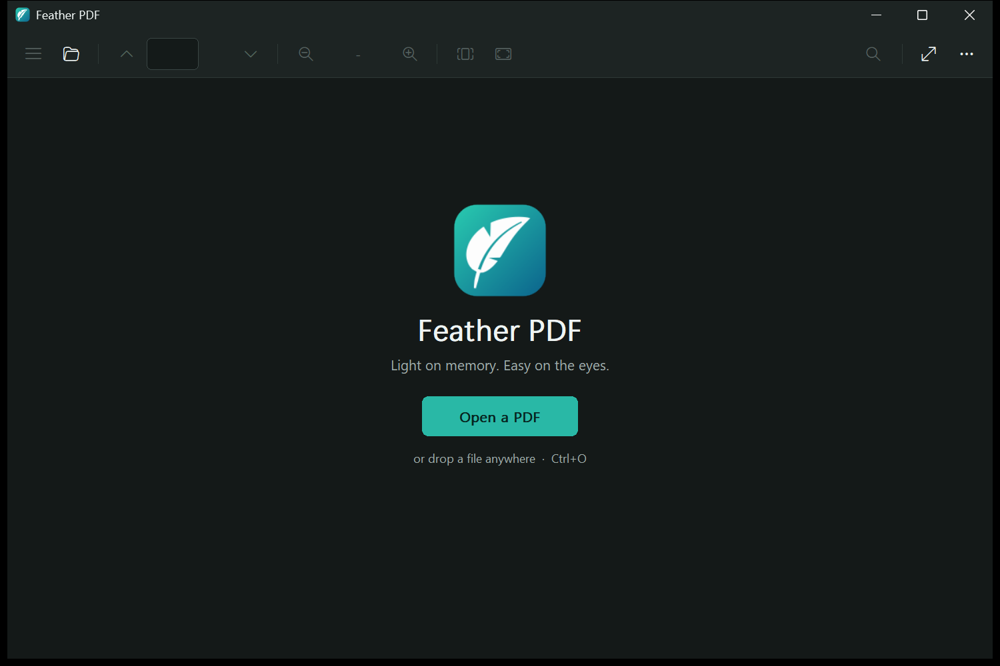
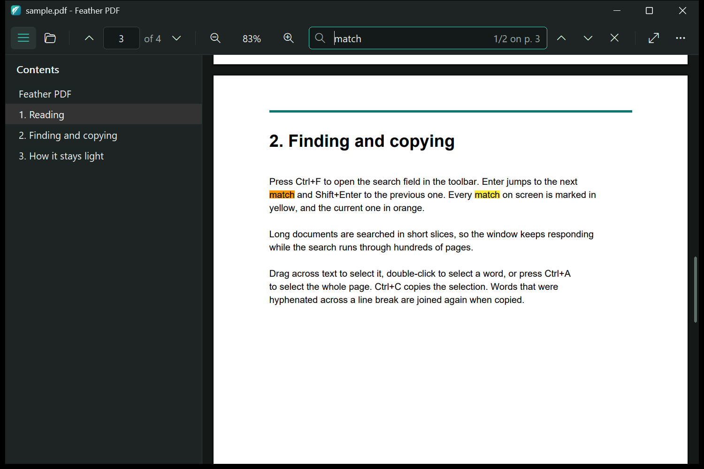
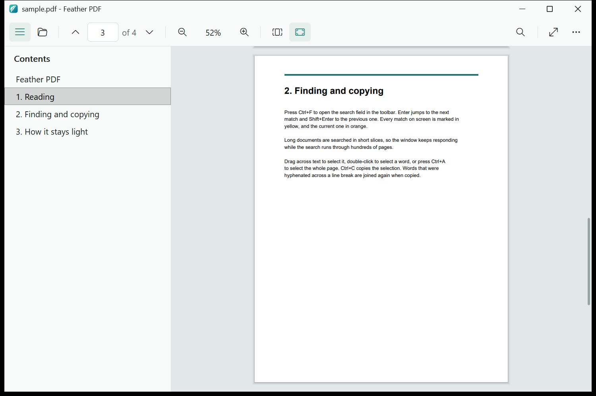

<p align="center">
  
</p>

<h1 align="center">Feather PDF</h1>

<p align="center"><b>Light on memory. Easy on the eyes.</b><br>
A fast PDF reader for Windows, written in Rust on top of PDFium.</p>

<p align="center">
  <a href="https://github.com/mohameddddt/feather-pdf/releases/latest"><b>Download for Windows</b></a>
</p>

---

Feather PDF draws its interface with plain Win32 and GDI: no browser engine, no UI framework.
With a 541-page, 21 MB textbook it uses about **16 MB** of memory after opening, and stays
**under 70 MB** while scrolling, zooming and searching through the whole book. The program
itself is a 0.8 MB executable plus the PDFium library.





## Features

- **Smooth reading**: continuous scrolling, fit width, fit page, actual size, and zoom from 10% to 800% that keeps the point under the mouse in place.
- **Contents sidebar**: the PDF's bookmarks as a tree; click an entry to jump there.
- **Search**: highlights every match on screen. Long documents are searched in the background, so the window never freezes.
- **Select and copy text**: drag to select, across pages if needed; double-click selects a word.
- **Picks up where you left off**: remembers the page, zoom and fit mode of every document.
- **Full screen** reading mode without toolbar or sidebar.
- **Dark and light themes** that follow your Windows setting, with a matching title bar.
- **Sharp on high-DPI displays**: per-monitor DPI aware, so pages and icons render at the display's real resolution.

## Download

Get the latest `FeatherPDF-*-win-x64.zip` from the [Releases](https://github.com/mohameddddt/feather-pdf/releases/latest)
page, unzip it anywhere, and run `featherpdf.exe`. There is no installer and nothing is written
outside your user profile. Keep `pdfium.dll` next to the executable.

To open PDFs by double-clicking them, right-click a PDF, choose **Open with > Choose another app**,
and pick `featherpdf.exe`.

Requires 64-bit Windows 10 or 11.

## Keyboard shortcuts

| Action | Shortcut |
|---|---|
| Open a file | Ctrl+O, or drop a file on the window |
| Find / next / previous | Ctrl+F / Enter or F3 / Shift+Enter or Shift+F3 |
| Copy selection | Ctrl+C |
| Select the text of the current page | Ctrl+A |
| Zoom in / out | Ctrl+Plus / Ctrl+Minus, or Ctrl+mouse wheel |
| Fit width / fit page / actual size | Ctrl+0 / Ctrl+2 / Ctrl+1 |
| Contents sidebar | Ctrl+B |
| Full screen | F11 (Esc to leave) |
| Scroll | Arrow keys, Page Up/Down, Space, Home/End |

Everything is also in the right-click menu and the **...** menu in the toolbar.

## How it stays light

- **Only visible pages are rendered**, at screen resolution, into a page cache with a fixed
  32 MB budget. The least recently used pages are dropped first, and the cache is emptied when
  the window is minimized.
- **Zoomed far in, only the visible part of a page is rendered**, so 800% zoom does not need a
  huge bitmap.
- **The file is read on demand** instead of being loaded into memory.
- **PDFium's internal caches are released**: PDFium keeps fonts and parsed data for every page it
  has touched until the document is closed. When that grows by more than 32 MB, Feather PDF
  quietly reopens the document; what you see on screen is unaffected.
- **No framework**: the toolbar, scrollbars and welcome screen are drawn with GDI; the icons come
  from the Segoe Fluent Icons font that ships with Windows.

## Building from source

Feather PDF builds with the GNU flavor of the Rust toolchain, which needs no Visual Studio
installation (the minimal toolchain is about a 130 MB download).

1. Install Rust with [rustup](https://rustup.rs), choosing the GNU host and the minimal profile:
   ```
   rustup-init.exe -y --profile minimal --default-host x86_64-pc-windows-gnu
   ```
2. Build:
   ```
   git clone https://github.com/mohameddddt/feather-pdf
   cd feather-pdf
   cargo build --release
   ```
3. Run `target\release\featherpdf.exe`. The build copies `pdfium.dll` next to it.

The only dependency is [`windows-sys`](https://crates.io/crates/windows-sys), Microsoft's Win32 bindings.

### How the build works

- `lib/pdfium.dll` is linked directly; MinGW's linker needs no import library for it.
- There is no resource compiler in the GNU toolchain, so `build.rs` draws the app icon itself
  (`build/logo.rs`, a small anti-aliased vector rasterizer) and writes the Windows resource
  object by hand (`build/resources.rs`): the icon at ten sizes plus the application manifest.

## Project layout

| Path | Contents |
|---|---|
| `src/main.rs` | The window: layout, page cache, painting, toolbar, search, selection, input |
| `src/ui.rs` | Theme colors, fonts, icon glyphs, drawing helpers, Windows theming calls |
| `src/pdfium.rs` | Bindings for the PDFium functions used: rendering, text, search, bookmarks |
| `src/positions.rs` | Saving and restoring reading positions |
| `build/logo.rs` | The logo, drawn from vector shapes |
| `build/resources.rs` | Writes the icon and manifest into a COFF resource object |
| `lib/` | `pdfium.dll` and its license notices |
| `docs/` | Screenshots and `sample.pdf`, a short document to try the reader with |

## Data stored on your computer

Reading positions are saved to `%APPDATA%\FeatherPDF\positions.tsv` (the last 200 files: page,
offset, zoom, fit mode and file path). Delete the file to forget them. Feather PDF does not
connect to the internet.

## License

Feather PDF is released under the [MIT License](LICENSE).

It ships with PDFium (BSD 3-Clause and Apache 2.0) and the libraries PDFium is built with; see
[lib/THIRD-PARTY-NOTICES.md](lib/THIRD-PARTY-NOTICES.md).
